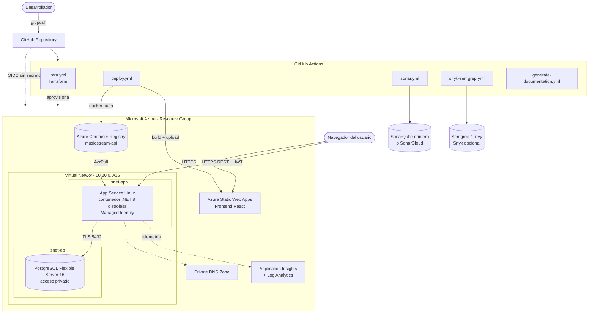

# Diagrama de despliegue

> Documento generado automáticamente por `MusicStream.DocGen` (workflow `generate-documentation.yml`). No editar manualmente.

Recursos declarados en Terraform (`infra/terraform`):

- `azurerm_application_insights.main`
- `azurerm_container_registry.main`
- `azurerm_linux_web_app.api`
- `azurerm_log_analytics_workspace.main`
- `azurerm_postgresql_flexible_server.main`
- `azurerm_postgresql_flexible_server_configuration.require_ssl`
- `azurerm_postgresql_flexible_server_configuration.log_connections`
- `azurerm_postgresql_flexible_server_configuration.log_checkpoints`
- `azurerm_postgresql_flexible_server_configuration.connection_throttling`
- `azurerm_postgresql_flexible_server_database.main`
- `azurerm_private_dns_zone.postgres`
- `azurerm_private_dns_zone_virtual_network_link.postgres`
- `azurerm_resource_group.main`
- `azurerm_role_assignment.acr_pull`
- `azurerm_service_plan.main`
- `azurerm_static_web_app.frontend`
- `azurerm_subnet.app`
- `azurerm_subnet.db`
- `azurerm_virtual_network.main`
- `random_password.postgres`
- `random_password.jwt`
- `random_password.admin`

